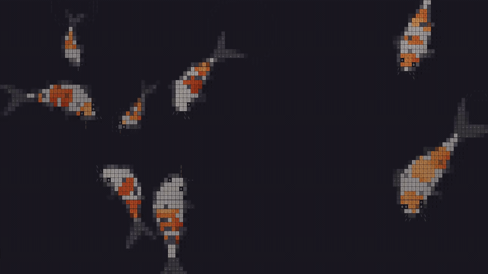

# Koi Pond

<p align="center">
  <a href="assets/koi-pond-demo.mp4">
    
  </a>
</p>

Koi Pond turns a Cinnamon X11 desktop into an animated ASCII koi pond. It runs locally through GTK and WebKitGTK, keeps desktop icons usable, and creates a separate animated surface for each monitor.

The preview links to a real 12-second recording of the pond at the current 16 fps setting, cropped to show only the fish without desktop icons or panels. The GIF preview is sampled at 8 fps. [Watch the MP4](assets/koi-pond-demo.mp4) · [Still preview](assets/koi-pond-demo.jpg) · [Text alternative](assets/accessibility.md).

## What it does

- Renders animated koi behind Nemo's desktop icons, with normal icon clicks preserved.
- Runs on multiple monitors, using one shared WebKit web process.
- Reacts to pointer movement. `Alt` + left click feeds the fish in desktop mode.
- Caps animation at 16 fps and pauses each monitor when an opaque window covers its work area.
- Respects `prefers-reduced-motion` and also runs as a standalone browser page.

## Install

Desktop mode requires Cinnamon on X11, Python 3, GTK 3, PyGObject, python3-xlib and WebKitGTK. On Linux Mint or an Ubuntu-based system, install the dependencies and launch from the checkout:

```bash
sudo apt install python3-gi python3-xlib gir1.2-gtk-3.0 gir1.2-webkit2-4.1
./wallpaper-start.sh
```

WebKitGTK 4.0 is supported when 4.1 is unavailable. The repository includes `pond.js`, so Node.js and a build step are optional for running the wallpaper. Desktop mode opens the local HTML file directly; it does not need an HTTP server. Stop a terminal-launched instance with `Ctrl+C`.

## Autostart

In Cinnamon's **Startup Applications**, add the absolute path to `wallpaper-start.sh` and set a 30-second delay. `wallpaper-interactive.sh` is an equivalent launcher. Keep the checkout at the configured path.

## Browser demo

```bash
./start.sh
```

Open [the dark theme](http://127.0.0.1:8765/) or [the light theme](http://127.0.0.1:8765/?theme=light). Move the pointer to interact and left-click to feed the fish. The server listens on `127.0.0.1:8765`; stop it with `Ctrl+C`.

## Compatibility and resource use

Desktop integration has been checked on Cinnamon 6.4.8 and Nemo 6.4.5 with 1920×1080 and 1920×1200 monitors. Desktop mode does not support Wayland. Other desktop environments have not been validated. The standalone browser page needs Canvas 2D support.

The current limit is 16 fps, with a 30 Hz simulation and a 1× canvas. Covered monitors resume within about a second. The pause check requires one opaque window to cover the work area; partial coverage or a combination of smaller windows keeps the animation running. A transparent panel may show a frozen frame while the rest of the monitor is covered.

Cinnamon may reserve `Alt` + click for moving windows. Logout/login and physical monitor hotplug remain untested. Earlier resource measurements used 8 fps and do not measure the current 16 fps setting. See the [desktop integration and measurement notes](README-INTERACTIVE.md).

## Security and data

The wallpaper reads local pointer state and window metadata for interaction and pause detection. It does not include telemetry or require an account, API key or runtime network connection. Browser mode serves the checkout through a loopback-only HTTP server. Building with `setup.sh` downloads esbuild from npm.

## Build and validation

To rebuild the checked-in TypeScript sources, install Node.js/npm and run:

```bash
./setup.sh
```

Run the local checks with:

```bash
/usr/bin/python3 -m unittest -v test_wallpaper
node test_main.cjs
```

The checks cover desktop stacking, monitor creation, opaque-window pause rules, pointer coordinates, the 16 fps timer, pause/resume, browser visibility and reduced motion. The video is a visual demonstration, not a performance benchmark.

## Attribution

The fish simulation, renderer and geometry derive from the original ASCII Koi Pond by **Dao Ho**, available in [the upstream portfolio](https://github.com/Dao-Ho/portfolio/tree/main/src/app/components/koi-pond). This adaptation adds Cinnamon X11 integration, multi-monitor handling and resource controls.

The demo is a cropped local screen recording of this adaptation. Check the upstream project's license and usage terms before redistributing its code or recordings.
